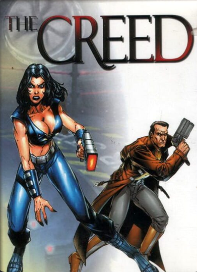

# The Creed (1999) – Unofficial Patch

<p align="center"></p>

Makes **The Creed** (Insomnia Entertainment / Dreamtime Interactive / Electronic Arts, 1999) playable on **Windows 10 and 11**, in full screen, with an optional **No-CD** mode and the **CD music** working again.

The Creed is a cyberpunk action-adventure that was famous for being buggy even in 1999. On modern Windows it would not install, crashed or showed black screens. This patch fixes the game's own bugs in `Creed.exe` and bundles a tested graphics/music setup.

> **Status:** community test release (v1.3). Tested on Windows 11 (Intel graphics) through the menus, intro and early gameplay, including Alt+Tab. Please [report](../../issues/new/choose) what works and what breaks.

By **Andromeda Kiwi + Claude**.

---

## Download & install

1. Download **`TheCreed_UnofficialPatch_v1.3.zip`** from [Releases](../../releases/latest).
2. *(Optional)* keep a copy of your original `Creed.exe`.
3. Extract the zip into your game folder (the one with `Creed.exe` and `Data\`) and overwrite.
4. Run `Creed.exe` and play.

No installer, no registry, no admin rights. With the CD in the drive the game behaves like the original.

**Requirements:** the *Hardware Accelerated* version of the game (`Data\Scene16.cus` present), `Creed.exe` **v1.6 build 160**. If the original CD setup does not run, copying the game files to a folder such as `C:\Games\The Creed` (not `Program Files`) is enough.

### Optional: play without the CDs
Run `Extras\CopyCDs.bat`. It asks for CD 1 ("Main") and CD 2 ("Data") and copies the ~120 MB the game reads from them into `cd1\` and `cd2\`. If those folders are missing the game just asks for the CD, as before.

### Optional: music
The ambient soundtrack is CD 1 audio tracks 2–19. Rip them with [fre:ac](https://www.freac.org/) (portable, free) to Ogg Vorbis as `Music\Track02.ogg` … `Music\Track19.ogg`. The bundled `winmm.dll` ([ogg-winmm](https://github.com/ayuanx/ogg-winmm)) plays them in place of the CD.

---

## What it fixes

| Problem | Cause | Fix |
|---|---|---|
| *"Non-Accelerated scene data not found"* | Mode chosen from a registry key the original installer wrote; without it the game forces software mode | `Creed.exe` no longer depends on the registry |
| Black menu backgrounds, mouse cursor trails | 640×480 background buffer created as a *texture* surface; modern DirectDraw refuses to blit it (`DDERR_UNSUPPORTED`) | Created as a plain off-screen surface |
| Crash a few seconds into gameplay | **Original 1999 bug**: depth-buffer "dirty rectangles" outside the screen are copied without clipping → access violation | Rectangles clipped to the buffer size |
| Alt+Tab / Ctrl+Alt+Del: game never comes back, mouse stuck | Focus-loss pause waits for DirectDraw exclusive mode, which the wrapper never reports back; keyboard opened in exclusive background mode | Pause driven by `WM_ACTIVATEAPP`; keyboard non-exclusive; dgVoodoo mouse capture off |
| Needs the CDs | Disc check by volume label (`CREED_MAIN` / `CREED_DATA`) to read `data.v00` / `Data.v01-03` | Uses `cd1\` / `cd2\` when present, otherwise the real CD |
| No music without the CD | CD-Audio via MCI | ogg-winmm |
| Graphics on modern GPUs | DirectDraw 6 + Direct3D HAL, 16-bit | dgVoodoo2 2.87.6 with a tested config |

All the details – addresses, disassembly and how each bug was found – are in **[docs/TECHNICAL.md](docs/TECHNICAL.md)**.

## Known issues

- Intro videos play in a window; the game goes full screen after Enter/Esc.
- Not yet tested to the end of the campaign (the game was infamous for freezing before the ending).
- Multiplayer untested. The *Non-Accelerated* (software/Ramp) version is not supported – its 3D renders almost black on modern systems.
- Don't run DxWnd at the same time; avoid saving from `dgVoodooCpl.exe` (see `patch/README.txt` for the settings that matter).

## Reporting problems

Open an [issue](../../issues/new/choose) with your Windows version, GPU and what you were doing. For crashes, run `Extras\EnableCrashDumps.bat` as administrator once – every crash then writes a `.dmp` into `CrashDumps\`; attach it.

## Repository layout

```
patch/            the release content, ready to extract into the game folder
  Creed.exe         patched executable (MD5 80BA90515BEA3D43BA223961CC63B150)
  DDraw.dll, D3DImm.dll, dgVoodoo.conf   dgVoodoo2 2.87.6 + config
  winmm.dll, winmm.ini                   ogg-winmm (CD music)
  Extras/           CopyCDs.bat (No-CD), EnableCrashDumps.bat
tools/patch_creed.py  rebuilds the patched Creed.exe from the original (stdlib only)
tools/dev/            the assembler scripts used to build the code caves (keystone/capstone)
docs/                 technical write-up and changelog
```

To verify the executable yourself: `python tools/patch_creed.py "C:\path\to\original\Creed.exe"`.

## Credits & licenses

- Patch, tools and docs: **Andromeda Kiwi + Claude** – [MIT](LICENSE).
- [dgVoodoo2](https://dege.freeweb.hu/) 2.87.6 by Dege – freeware, included unmodified.
- [ogg-winmm](https://github.com/ayuanx/ogg-winmm) by ayuanx – GPL-2.0, built unmodified from source (see `patch/Licenses/`).
- *The Creed* © 1998 Insomnia Entertainment Pty Limited; box art shown for identification only. This is an unofficial fan patch, not affiliated with Insomnia Entertainment, Dreamtime Interactive or Electronic Arts. The game is abandonware; no game data files are included.
